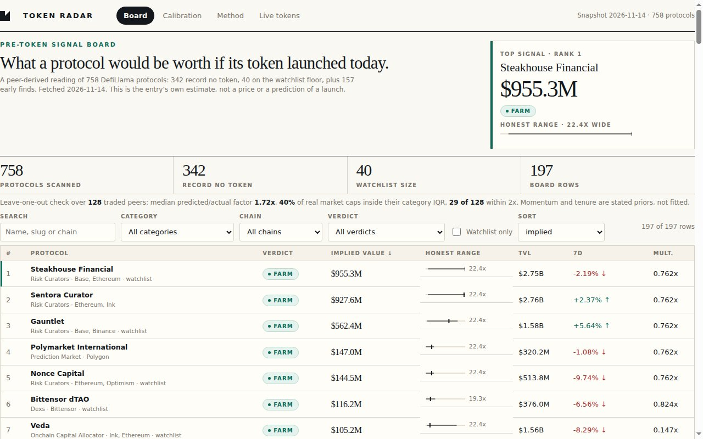
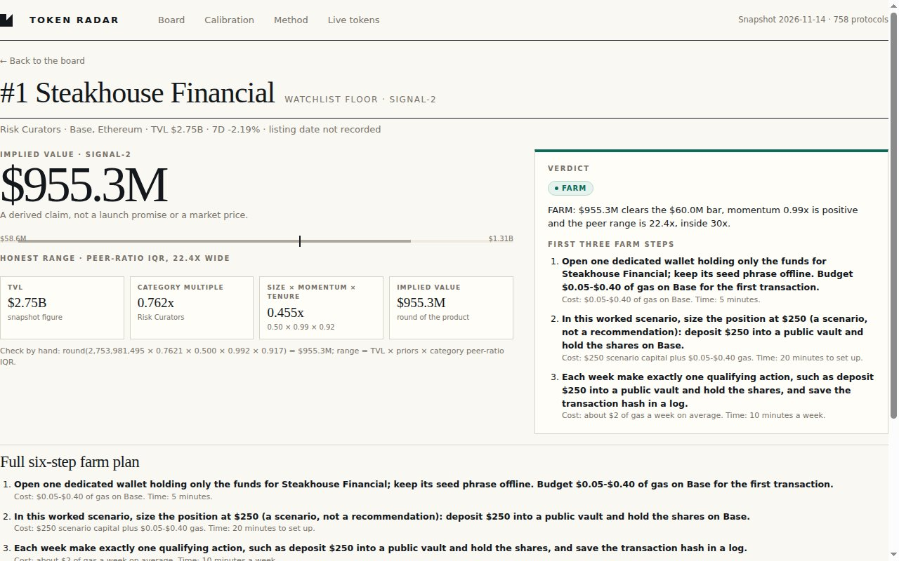

# Token Radar — signal-2


Entry for make.fun's [token-radar-01 bounty](https://make.fun/c/token-radar-01): build the best token launch radar.
Bounty page and rules: [competition](https://make.fun/c/token-radar-01) · [account](https://make.fun/u/nici).

## What it does

`main.ts` reads the sealed snapshot (758 DefiLlama protocols) and writes a 197-row board of pre-token
protocols ranked by an implied value. The board covers all 40 watchlist slugs and adds 157 early finds
the watchlist leaves out. Protocols whose token already trades are set aside as yardsticks, never ranked.

The value model, `signal-2`, is one function of the snapshot's own figures:

- `ratio = mcap / TVL` for every traded peer, winsorised at the 90th percentile.
- `globalMultiple` is the median capped ratio; `categoryMultiple` shrinks each category toward it by
  four phantom peers; `refTvl` is the median traded-peer TVL.
- `size = clamp((TVL/refTvl)^-0.30, 0.5, 2.0)`, `momentum = 1 + 0.35 × clamp(change7d, -60, 150)/100`,
  `tenure = 0.75 + min(ageDays, 1460)/1460 × 0.45`.
- `implied = max(1, round(TVL × categoryMultiple × size × momentum × tenure))`.
- The honest range is the category peer-ratio IQR. It is uncertainty, not a launch promise.

Verdicts: **FARM** (≥$60M, momentum ≥0.95x, range ≤30x), **WATCH** (≥$20M, range ≤60x), otherwise
**SKIP** with a cheap watch plan naming the trigger that would flip it.

Calibration is leave-one-out over all 128 traded peers, with a 256-refit seeded bootstrap of the global
multiple. Momentum and tenure are labelled as priors the snapshot cannot fit. Every one of the 758
protocols is reconciled: board rows + already tokened + screened out (with reason counts) + below cut.

## Dashboard

An editorial signal desk: warm paper, ink rules, serif numerals, and colour used only for the three
verdicts. Board, Calibration, Method and Live tokens tabs; search, category, chain, verdict and
watchlist filters; sortable columns; a detail view for every protocol with the multiplication chain,
the honest-range bar and the costed six-step farm plan.




## Run it

```bash
mkdir -p out
MAKEFUN_OUTPUT_DIR=out node main.ts --input ../input/snapshot.json
```

Node 22.18 or later runs the TypeScript directly. On Node 22.6–22.17 use
`node --experimental-strip-types main.ts`. No dependencies, no network, no clock and no unseeded
randomness: two runs into different output directories produce byte-identical files.

Outputs: `out/board.json`, `out/data.js`, `out/dashboard/`, `out/screenshots/`, `out/dossier.json`.

## Layout

```
main.ts                     entrypoint and preflights
lib/model.ts                signal-2 model, calibration, accounting, farm plans
vendor/makefun-board.ts     dossier writer (contract-compatible)
dashboard/index.html        page shell
dashboard/app.css           signal desk theme
dashboard/app.js            board, calibration, method, live and detail views
screenshots/                four 1280x800 captures of the rendered page
```

MIT licensed. The implied values are this entry's own estimates, not make.fun's and not financial advice.

[make.fun](https://make.fun/?ref=1n20pv53)
